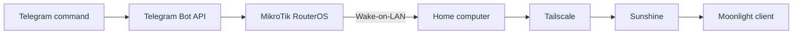

<div align="center">

# WakeOnEarth

### Power on and access your computer from anywhere with Telegram and MikroTik.

A lightweight Wake-on-LAN workflow built with infrastructure that is already online —
no Raspberry Pi, smart plug, dedicated server, or exposed inbound port required.

<p>
  
  
  <a href="./LICENSE"></a>
</p>

[**Setup guide**](./install.md) ·
[View the RouterOS script](./mikrotik/mikrotik.rsc) ·
[Understand the architecture](#architecture)

</div>

## The problem

Remote access normally requires leaving a computer powered on all day or adding another always-on device. WakeOnEarth uses the MikroTik router that is already running at home as a small automation controller.

A Telegram command reaches the router, which sends the Wake-on-LAN packet and reports whether the computer or internet connection is available. After startup, Tailscale provides private connectivity while Sunshine and Moonlight handle remote desktop and game streaming.

## What it does

<table>
  <tr>
    <td width="33%" valign="top">
      <strong>Remote power-on</strong><br>
      Sends a Wake-on-LAN magic packet from RouterOS after receiving a Telegram command.
    </td>
    <td width="33%" valign="top">
      <strong>Computer status</strong><br>
      Pings the target computer and reports whether it is online or offline.
    </td>
    <td width="33%" valign="top">
      <strong>Connection check</strong><br>
      Measures internet availability and classifies the observed latency.
    </td>
  </tr>
</table>

## Architecture



The router polls the Telegram Bot API on a schedule. Commands are processed locally by the RouterOS script; remote access itself travels through Tailscale instead of a public port-forwarding rule.

## Commands

| Command | Result |
| --- | --- |
| `turnon` | Sends the Wake-on-LAN packet to the configured MAC address |
| `status` | Checks whether the target computer responds on the local network |
| `internet` | Reports internet availability and average latency |

## Quick start

1. Create a private Telegram bot with BotFather.
2. Copy [`mikrotik/mikrotik.rsc`](./mikrotik/mikrotik.rsc) and replace the token, chat ID, MAC address, target IP and LAN interface placeholders.
3. Import the script into RouterOS and schedule it to run periodically.
4. Enable Wake-on-LAN in the target computer's BIOS/UEFI and network adapter.
5. Follow the [complete installation guide](./install.md) to configure Tailscale, Sunshine and Moonlight.

```routeros
/import mikrotik.rsc
```

> [!CAUTION]
> The current proof-of-concept script does not validate the sender ID independently from the configured chat destination. Keep the bot private, never commit its token, and add explicit sender validation before using it in a shared bot or group.

## Engineering highlights

| Area | Implementation |
| --- | --- |
| Network automation | RouterOS scripting, scheduled polling and Wake-on-LAN |
| External integration | Telegram Bot API through RouterOS `/tool fetch` |
| Diagnostics | ICMP checks for host availability, packet loss and average RTT |
| Remote access | Private Tailscale network with Sunshine and Moonlight |
| Deployment | Single configurable `.rsc` script with no additional hardware |

## Configuration placeholders

The distributed script contains placeholders only:

```routeros
:local token "YOUR_BOT_TOKEN";
:local chatid "YOUR_CHAT_ID";

/tool wol \
    mac=XX:XX:XX:XX:XX:XX \
    interface=Bridge-LAN;
```

Do not publish a configured copy. Bot tokens, chat IDs, internal addresses and MAC addresses should remain outside version control.

## Project structure

```text
WakeOnEarth/
├── mikrotik/
│   └── mikrotik.rsc   # RouterOS automation
├── install.md         # End-to-end setup and troubleshooting
├── LICENSE
└── README.md
```

## Author

Created by **[Rafael Caires Pires](https://github.com/rafaelcairess)**, NOC Analyst focused on networking, Linux, Python and automation.

[LinkedIn](https://www.linkedin.com/in/rafael-caires-pires-58225b238) ·
[Open an issue](https://github.com/rafaelcairess/WakeOnEarth/issues)

Distributed under the [MIT License](./LICENSE).

<div align="center">

If WakeOnEarth is useful or inspires another automation project, consider leaving a ⭐.

</div>
